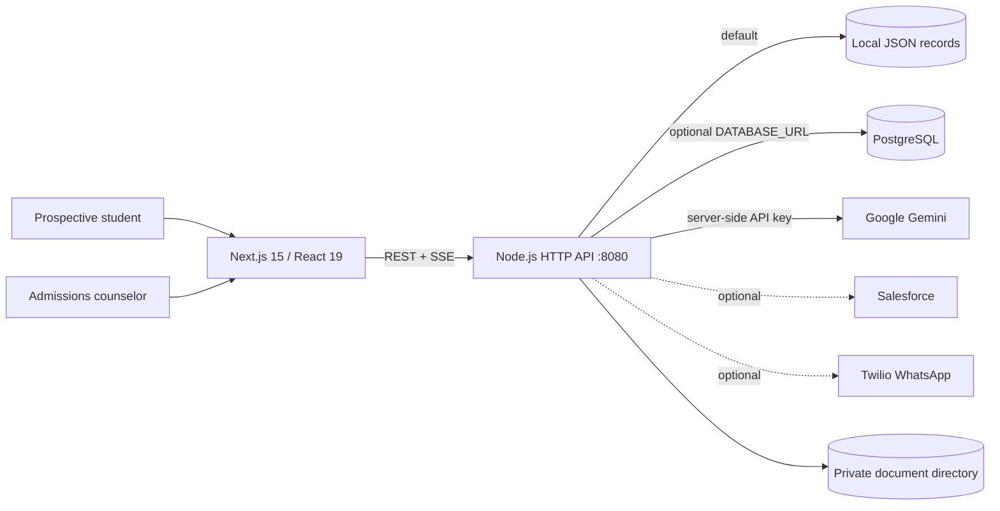

# Architecture

## Runtime overview

The frontend is a Next.js App Router application. It contains the public programme and support pages, the student application wizard, and the counselor portal. `Frontend/lib` centralizes API configuration and chat event parsing. The backend is a dependency-light Node HTTP server in `Backend/mock-server/server.js`; it serves application JSON, protects counselor routes with HMAC-signed JWTs, proxies Gemini SSE, and conditionally connects to the listed external services.

## Trust boundaries

- Browser code receives only public API base URLs. Gemini and integration credentials are backend-only.
- `CORS_ORIGINS` is an explicit comma-separated allowlist. Add the exact deployed frontend origin before deployment.
- Counselor-only routes verify the token signature, expiry, role, and configured counselor subject on every request. Browser route checks are only a user-experience guard.
- Uploaded documents have file-count, size, MIME, and signature checks; they are stored outside `Frontend/public` and exposed only through an authenticated download route.
- JSON files and local uploads are demonstration storage, not hardened production storage. Back them up, restrict host access, and establish retention before real applicant data is introduced.

## Data flow

Public inquiries are validated and saved locally before optional Salesforce synchronization. Applications are validated, assigned a pending-review status, optionally save bounded private documents, then are written to PostgreSQL when configured and to the JSON local cache. Nemo requests are streamed from the browser through the backend to Gemini; no simulated response is returned when the AI credential is unavailable. Counselor application actions update the record in the selected store.
